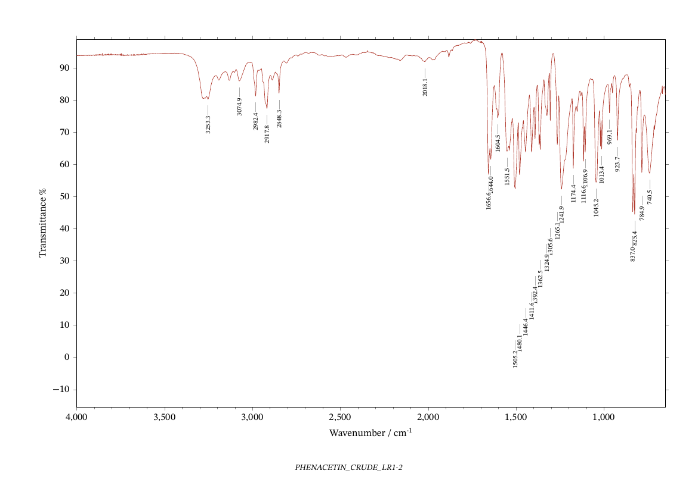

# irspec

Infrared spectra for chemistry students. Put the files from the instrument, from
NIST WebBook or from SDBS in a folder, run one command, and get tidy CSVs, peak
lists and report-quality figures (PDF, PNG, TIFF, SVG) back.



*Above: the author's own phenacetin spectrum, from `irspec session` with
`--formats png`.*

```
irspec session my_lab_folder/ --formats png,svg
```

**Contents:** [Status](#status) · [What it does](#what-it-does-and-what-it-does-not) ·
[Install](#install) · [Quick start](#quick-start) · [Inputs](#the-three-kinds-of-input) ·
[Names](#names) · [CSV files](#csv-files) · [Manifest](#the-manifest) ·
[Pictures](#pictures-png-tiff-svg) · [Without TeX](#drawing-without-tex-matplotlib-and-r) ·
[PDF build](#how-the-pdf-is-made) · [All commands](#the-other-commands) ·
[Trust](#can-i-trust-the-output) · [Versioning](#versioning) · [Roadmap](#roadmap) ·
[Development](#development) · [Licence](#licence)

## Status

**Alpha, version 0.1.0.** The command line and the folder layout below work and are
tested, but before 1.0 a new minor version (0.2, 0.3, ...) may change them: pin
the minor version if something depends on irspec. The Python code (`import
irspec`) is not a stable interface before 1.0: use the command line. See
[Versioning](#versioning) and `CHANGELOG.md`.

## What it does, and what it does not

It does:

- read the Thermo OMNIC `.SPA`/`.SPG` files of a Nicolet iS5 FTIR (the instrument it was
  written for; other OMNIC files are read the same way, but only this one is tested),
  NIST WebBook `.jdx` (JCAMP-DX) files, and spectra that exist only as a picture
  (SDBS plots) by reading the trace off the image;
- write each spectrum as two CSVs (see [CSV files](#csv-files)), pick its peaks
  and draw it with the labels kept apart;
- put every spectrum on the same axis, **%Transmittance**: an Absorbance
  spectrum is converted on purpose, never mixed in silently;
- make a PDF with one spectrum per landscape page, and PNG/TIFF/SVG copies of
  each page named after the spectrum;
- or draw the same figures without TeX, with matplotlib or with R (ggplot2), if
  you would rather have those ([below](#drawing-without-tex-matplotlib-and-r)).

It does not interpret spectra, assign bands or identify compounds. The peak
labels are wavenumbers; deciding what a band is stays your job. Peak picking is a
convenience, and the manifest lets you correct it ([below](#the-manifest)).

## Install

Needs Python 3.9 or newer.

```
pip install irspec       # or: pipx install irspec
irspec --version         # python -m irspec --version does the same
```

From a checkout of [the repository](https://github.com/aliperdehan/irspec) instead:
`pip install .` (or `pip install -e .` while developing).

This pulls in numpy, scipy and Pillow. The rest are programs irspec calls, and
only the ones for the output you ask for are needed:

| You want | Needs | macOS | Debian/Ubuntu |
|---|---|---|---|
| a PDF | `lualatex` with pgfplots (TeX Live or MacTeX) | `brew install --cask mactex-no-gui` | `apt install texlive-full` |
| PNG, TIFF, SVG | poppler (`pdfinfo`, `pdftoppm`, `pdftocairo`) | `brew install poppler` | `apt install poppler-utils` |
| SVG with editable text | MuPDF (`mutool`) | `brew install mupdf-tools` | `apt install mupdf-tools` |
| matplotlib figures (`irspec plot`) | the matplotlib package: `pip install ".[matplotlib]"` | | |
| R figures (`irspec plot --backend r`) | R with `ggplot2`, `jsonlite`; `ragg`, `svglite` recommended | `brew install --cask r` | `apt install r-base` |
| `digitize --omnic` | `tesseract` | `brew install tesseract` | `apt install tesseract-ocr` |

The figures use the font STIX Two when it is installed. When it is not, they use
the copies bundled with irspec (see [Licence](#licence)), so a figure looks the same
on a machine that does not have the font. If a program is missing, irspec says which one
and what to install instead of failing with a traceback.

On macOS the Homebrew `python3` refuses a bare `pip install` ("externally
managed environment"); use a virtual environment
(`python3 -m venv ~/irspec-venv && ~/irspec-venv/bin/pip install .`) or `pipx`.

## Quick start

1. Make a folder and drop the files in it. Loose files are sorted for you:
   `.SPA`/`.SPG` into `SPA/`, `.jdx` into `jdx/`, anything else into `other/`.
   **Pictures are the exception**: put an SDBS plot (`.gif`, `.jpg`, `.png`,
   `.bmp`) in `img/` yourself, because a screenshot of the instrument and a
   published plot are both "an image" and irspec cannot tell which you mean.
2. Run it:

   ```
   irspec session my_lab_folder/
   ```

3. Look at the PDF it wrote, then fix whatever you disagree with in
   `manifest.json` (a title, a peak) and run the same command again. A re-run
   keeps your edits.

After a run on one `.SPA` file the folder looks like this:

```
my_lab_folder/
  SPA/PHENACETIN_CRUDE_LR1-2.SPA            the file, moved here
  csv/PHENACETIN_CRUDE_LR1-2.csv            archival CSV
  plain/PHENACETIN_CRUDE_LR1-2_plain.csv    the CSV the figure reads
  manifest.json                             titles, peaks, per-spectrum settings
  figures.json                              the figures as the drawing backends read them
  ir_my_lab_folder.md                       the figure list, for nulabreport's pdfmd
  ir_my_lab_folder.tex                      the same for plain lualatex  (--build latex)
  ir_my_lab_folder.pdf                      the figure PDF, one spectrum per page
  figures/PHENACETIN_CRUDE_LR1-2.png        with --formats (from the PDF)
  figures/matplotlib/..., figures/r/...     with irspec plot
```

The base name `ir_...` is `ir_<dd-mm>` when the folder's name contains a date
(`own-29.09` gives `ir_29-09`), else `ir_` and the folder's name.
`--md-name NAME` chooses it yourself.

### Options of `irspec session`

| Option | Meaning |
|---|---|
| `--dry-run` | print the file moves and stop |
| `--build auto\|pdfmd\|latex\|none` | how the PDF is made (`--no-pdf` is `none`); the run says which build it used, see [How the PDF is made](#how-the-pdf-is-made) |
| `--pdfmd PATH` | the `pdfmd` to use (otherwise `$PDFMD`, else `pdfmd` on the PATH) |
| `--sort time\|name` | order of new files (modification time by default) |
| `--title STEM=TITLE` | set a caption from the command line (repeatable) |
| `--md-name NAME` | base name of the `.md`/`.tex`/`.pdf` |
| `--formats LIST`, `--dpi N` | also write PNG/TIFF/SVG, see [Pictures](#pictures-png-tiff-svg) |

## The three kinds of input

| Source | Goes in | What happens |
|---|---|---|
| The lab's own instrument file (`.SPA`, `.SPG`) | `SPA/` | decoded directly (checked against a Spectragryph export to 0.0000 %T); peaks picked |
| NIST WebBook `.jdx` | `jdx/` | **Transmittance** is rescaled 0–1 → 0–100; **Absorbance** is converted to %T; **QUANT-IR gas-phase** files (absorptivity, not an absorbance) need `peak_a` or `cl` in the manifest, see below |
| A spectrum published only as a picture (SDBS) | `img/` | the trace is read off the image and drawn back over it as a check; a failed calibration or redraw check **stops the run** and names the log in `check/` |

`.jdx` files that use JCAMP's compressed number formats (SQZ/DIF/DUP) are
refused with a message rather than decoded wrongly.

### QUANT-IR gas-phase files

These carry an absorptivity (absorbance per µmol/mol per metre), not an
absorbance, and the file does not say what concentration or path length it was
measured at. irspec will not invent one. Say what to scale the strongest band to,
and say so in your caption:

```json
{"file": "jdx/1634-04-4-IR.jdx", "name": "MTBE_GAS", "peak_a": 1}
```

`"cl": <c×L in µmol/mol·m>` is the alternative when you know the product.

## Names

An instrument spectrum keeps its file's stem: `SPA/RUN3.SPA` gives
`csv/RUN3.csv` and `plain/RUN3_plain.csv`. A reference spectrum (`jdx/`, `img/`)
gets a name in capitals with underscores and no spaces, `csv/NAME.csv` and
`plain/NAME.csv` (no `_plain`; the difference is deliberate). The name comes from,
in this order:

1. `"name"` in its manifest entry;
2. `cas_names.json` in the session folder, looked up by the CAS number the file
   name starts with: `{"67-56-1": "METHANOL_GAS", "103-90-2": "ACETAMINOPHEN"}`;
3. the file's own stem (a WebBook file is called after its CAS number, so this
   is rarely what you want).

## CSV files

Two files per spectrum, because the two jobs want different things:

| | archival `csv/` | plain `plain/` |
|---|---|---|
| separator | semicolon | comma |
| decimal mark | comma | point |
| order | descending wavenumber | ascending |
| range | everything the file has | 650 cm⁻¹ and up |
| y | as decoded, never converted | %T, the figures' axis |
| use | keeping the data as it came | plotting, peak picking, correlation, other programs |

The plain CSV has a header line and two columns, wavenumber and intensity; a
spreadsheet, R, matplotlib or pgfplots reads it as it is. The archival form is
the shape Spectragryph exports.

## The manifest

`manifest.json` is the one place a session is configured. It is a list with one
entry per spectrum, in figure order, written by the first run and kept on every
re-run: your edits stay, new files are appended, vanished files are dropped.

```json
[
  {
    "file": "SPA/PHENACETIN_CRUDE_LR1-2.SPA",
    "title": "Phenacetin (crude)",
    "peaks": [[740.5, 52.3], [1241.9, 47.3], [3253.3, 75.3]],
    "ymin": -5
  }
]
```

| Key | Meaning |
|---|---|
| `file` | path of the spectrum, relative to the folder (`SPA/…`, `jdx/…`, `img/…`) |
| `title` | the caption under the figure, free text (`"Alcohol (stock)"` is fine). A new entry starts with the file's stem (an instrument spectrum), or with its compound name (`"METHYL_CINNAMATE_GAS"` gives "Methyl cinnamate gas"), or with the title inside the `.jdx`; change it here |
| `peaks` | `[wavenumber, label_y]` pairs, as picked; edit, add or delete here. A bare number is snapped to the nearest local band. Delete the key to pick again |
| `axis` | y-axis label (default `Transmittance %`) |
| `ymin` | bottom of the y axis; the tool's suggestion is kept as it is, and may be negative for a strong band |
| `threshold`, `prominence`, `distance` | peak-picking sensitivity overrides, for a band at the plot edge or noise taken for bands |
| `name` | the reference name above (written back by the first run) |
| `peak_a`, `cl` | QUANT-IR files only, see above |
| `check` | pictures only: the peak table printed under the SDBS plot, typed as `"3490:84,2977:6,…"`, for the digitiser's own cross-check |
| `args` | pictures only: extra flags for `irspec digitize convert`, as a list. For a book figure: `["--palleros", "--x-ticks", "3500,3000,2500,2000,1500,1000", "--y-ends", "72.7:24.5"]`, with `check` set to the band positions printed under the troughs (`"3027.1,2948.8,..."`); those printed positions then become the peak labels, not the peak finder's |

## Pictures: PNG, TIFF, SVG

`--formats` takes a comma-separated list. The pictures are made **from the figure
PDF**, one file per spectrum into `figures/`, so they all look like the PDF.

| Format | File | Made by | Notes |
|---|---|---|---|
| `png` | `NAME.png` | poppler | `--dpi` (default 300) |
| `tiff` | `NAME.tiff` | poppler | LZW-compressed, the same pixels as the PNG |
| `svg` | `NAME.svg` | poppler (`pdftocairo`) | looks exactly like the PDF anywhere; text is drawn as outlines, so it **cannot be edited as text** |
| `svg-text` | `NAME_text.svg` | MuPDF (`mutool`) | labels stay real `<text>` for Inkscape or Illustrator; the fonts' names are kept, so **STIX Two must be installed** where it is opened; TeX's word gaps are not space characters, so a label reads "Transmittance%" in an editor while it draws correctly |

A PDF you already have can be converted without a session:
`irspec export fig.pdf --formats png,tiff --dpi 600 --out pics/ --names A,B,C`
(`--names` gives the file stems in page order; without it the pages are called
`page-1`, `page-2`, …; the default folder is `figures/` beside the PDF).

## Drawing without TeX: matplotlib and R

`irspec session` also writes `figures.json`: the figures (the plain CSV, title,
y-axis label, peaks, `ymin`) in a form that knows nothing about OMNIC, JCAMP or
TeX. Two more drawing programs read it, and neither needs TeX:

```
irspec plot my_lab_folder/                                  # matplotlib: PNG
irspec plot my_lab_folder/ --formats png,svg-text,pdf       # more formats
irspec plot my_lab_folder/ --backend r --formats png,svg    # R and ggplot2
Rscript irspec.R my_lab_folder/ --formats png               # R, without Python
```

(`irspec plot --print-r-script` prints where `irspec.R` is; the script stands
alone, so a class that works in R needs only that file and a `figures.json`.)
Pictures go to `figures/matplotlib/` or `figures/r/`, so they never overwrite
the ones made from the TeX PDF. Options: `--formats`, `--out`, `--size
WIDTHxHEIGHT` in inches (default 10x6.6), `--dpi` (300), `--no-caption`.

| | matplotlib | R |
|---|---|---|
| needs | `matplotlib` | R with `ggplot2`, `jsonlite` (`ragg` for PNG/TIFF and `svglite` for SVG are used when installed) |
| formats | png, tiff, pdf, svg (text as outlines), svg-text (editable text) | the same five; pdf and svg need an R with working cairo (on macOS, CRAN's R has it only with XQuartz: `brew install --cask xquartz`), the others do not |
| font | STIX Two Text if installed, else the bundled copy; the one used is printed | the same (the R script looks for the bundled copy in the `fonts/` folder beside it, so keep that folder with it) |

All three drawings (TeX, matplotlib, R) share one set of numbers
(`src/irspec/layout.py`), measured on the TeX figure: the axis box, the x axis
from 4000 to 650 cm⁻¹, the trace (0.5 pt, `#B03A2E`), the peak labels (8 pt,
rotated, hanging below their `label_y` on a short grey leader tick) and where
the y axis starts and stops. They differ in the y tick spacing (pgfplots' rule
is its own), in antialiasing, and in where the caption sits, so *the same
figure*, not the same pixels. The TeX version remains the reference.

## How the PDF is made

`--build auto` (the default) uses:

- **`pdfmd` + nulabreport**, if both are installed: the `.md` is built by the
  author's own report pipeline (`pdfmd` is public, `pip install pdfmd-cli`;
  `nulabreport` is the author's LaTeX style for Nazarbayev University lab reports
  and is not public), so the figures come out in the house style of those reports.
  Nobody else needs this;
- otherwise **plain `lualatex`** on the generated `.tex`. That document loads the
  real `nulabreport.sty` when TeX can find it and else the bundled excerpt
  `irspec-ir.sty`, which irspec copies beside the `.tex`.

The excerpt is cut mechanically out of nulabreport.sty (its header names the
version) and draws the same page: on the author's phenacetin spectrum the two
differ in 0 pixels, and nulabreport's smoke test checks that the committed
excerpt is what its markers generate. It is a fallback, not a second
implementation, with two limits: it understands only the `captions` setting of
`\labsetup` (`furniture` is accepted and ignored), and it can lag behind the full
package. Where they disagree, the full package is right.

## The other commands

`session` is what most people want; the others are its steps, for when one step is
all you need. Each has its own `--help`.

| Command | Does | Example |
|---|---|---|
| `irspec session DIR` | the whole thing above | `irspec session own-29.09/ --formats png` |
| `irspec export PDF` | PNG/TIFF/SVG from a PDF | `irspec export fig.pdf --formats svg` |
| `irspec plot DIR` | the figures drawn by matplotlib or R, no TeX | `irspec plot own-29.09/ --backend r --formats png` |
| `irspec spa` | `.SPA` → CSVs and peaks; `batch` for several, `plot` for a legacy matplotlib PNG/SVG | `irspec spa convert run.SPA` |
| `irspec jdx` | `.jdx` → CSVs, one file or a folder | `irspec jdx convert X.jdx --name X --out csv/X.csv --plain-out plain/X.csv` |
| `irspec peaks` | peak-pick a `.SPA`, `.jdx` or CSV | `irspec peaks plain/X.csv` |
| `irspec digitize` | a picture → CSVs, with a redraw check | `irspec digitize convert img/X.gif --name X --out csv/X.csv --plain-out plain/X.csv` |
| `irspec a2t` | Absorbance → %T (`--to absorbance` for the other way) | `irspec a2t plain/X.csv --out plain/X_T.csv` |
| `irspec absorptivity` | QUANT-IR absorptivity → Absorbance | `irspec absorptivity X.jdx --name X --out csv/X.csv --plain-out plain/X.csv --peak-a 1` |
| `irspec corr` | Pearson r between spectra (the first is the reference) | `irspec corr plain/REF.csv plain/UNKNOWN.csv` |

`digitize` has two more layouts than SDBS: `--palleros` for book figures and
`--omnic` for OMNIC screenshots (this one reads the tick labels with tesseract).
The module docstrings are the long documentation of each tool: what was checked,
and how.

## Can I trust the output?

The tools began as the IR scripts of the author's lab-report package and were
moved here without changing what they compute. The tests
(`PYTHONPATH=src python3 -m unittest discover -s tests`) hold that in place:

- the CSV pair for the author's own phenacetin spectrum is compared byte for byte
  with the ones the original scripts made;
- sixteen commands are run by the original scripts and by the package on the same
  inputs, and the exit code, the output and every written file are compared;
- the Markdown a session writes is compared with what the original organizer
  wrote, and the plain-`lualatex` page with the full-package page, pixel for pixel;
- every exported file is compared with `pdftoppm` of its own PDF page;
- the y limits of the drawing code are held to what the TeX figure really draws
  (frame and tick positions read from the PDF on six y ranges); the matplotlib
  figure's line data, limits, label texts and positions are compared with the
  CSV and the peak list; the R script's limits and ticks are compared with the
  Python ones.

Three more checks run on the author's own coursework folders (the environment
variable `IRSPEC_LR6_IR` points at them) and are skipped everywhere else; they
are how the WebBook and SDBS paths were shown to give byte-identical CSVs.

The one sample spectrum in `tests/data/` is the author's own. No other student's
data and no instructor's material is in this repository.

## Versioning

`0.MINOR.PATCH` until 1.0, then [Semantic Versioning](https://semver.org).

- **Minor** (`0.1.0` → `0.2.0`): a new feature, or anything that could break a
  folder or a script someone already has: a command-line flag renamed or removed,
  a manifest key or the folder layout changed, the CSV or figure format changed.
- **Patch** (`0.1.0` → `0.1.1`): a fix, documentation, tests, a regenerated
  excerpt that draws the same page.
- **`SPEC_VERSION`** (in `irspec/figure.py`, now 1) is a separate integer, written
  into figure descriptions. It changes only when the manifest/figure format breaks,
  and it is frozen at 1.0.
- **0.1.0** is the first release: the TeX pipeline, the exports and the matplotlib
  and R backends; **1.0.0** is planned for when the formats have settled.
- The version lives in one place, `irspec.__version__`. A release is a git tag
  `vX.Y.Z` plus an entry in `CHANGELOG.md`. The bundled excerpt records which
  nulabreport version it was cut from.

Anything that depends on irspec before 1.0 should pin the minor version
(`irspec>=0.1,<0.2`).

## Roadmap

The first release is out (PyPI, public repository). Planned, in this order; none of it exists yet:

- **Editing from the command line** (`irspec edit`: add and remove peaks, set a title or a range),
  `--json` output and a written description of the manifest, so scripts and AI agents can drive
  everything a person can;
- **A preview in the terminal** (`irspec preview`, `session --preview`): the spectrum drawn in
  text to the width of the terminal, with what the run is going to do;
- **`\irspectrum` reading `.SPA` and `.jdx` files directly** in LuaTeX, with automatic peaks
  and the x and y ranges chosen in the call, so a report needs no CSV;
- optional **smoothing, baseline correction and band areas**, off by default, the raw data never
  changed;
- **1.0** when the command line, the manifest and the figure format have settled;
- perhaps a small **Mac app** over the same commands, built from this repository (`app/`).

The reasons and the design are in [`docs/roadmap.md`](docs/roadmap.md).

Out of scope: MS, NMR, GC and TLC tools, identifying compounds, and anything that extracts figures
from copyrighted books.

## Development

```
PYTHONPATH=src python3 -m unittest discover -s tests
```

The original scripts the code came from are in the git history (tag `legacy-oracle`, folder
`legacy/`; see `PROVENANCE.md`); the tests compare against what they produced, recorded
in `tests/data/`. `irspec-ir.sty` is
generated and never edited: change `nulabreport.sty` and regenerate it.

### Releasing

The version bump and the `CHANGELOG.md` entry go in one commit on `main`; then the tag:
`git tag -a vX.Y.Z -m "irspec X.Y.Z" && git push origin vX.Y.Z`. The tag starts
`.github/workflows/publish.yml`, which refuses a tag that is not `irspec.__version__`,
runs the tests, builds, and uploads to PyPI by trusted publishing (no token is stored; the
PyPI project lists this repository, `publish.yml` and the environment `pypi`).

## Licence

irspec is MIT, see `LICENSE`. It bundles three unmodified fonts from the STIX
Fonts Project (STIX Two Text Regular and Italic, STIX Two Math; about 1.9 MB), which
are under the SIL Open Font License 1.1, not MIT: the notice and the license text
are in `src/irspec/data/fonts/` (`OFL.txt`, `README.txt`) and travel with every copy,
as the license asks. They are used only when STIX Two is not installed.
